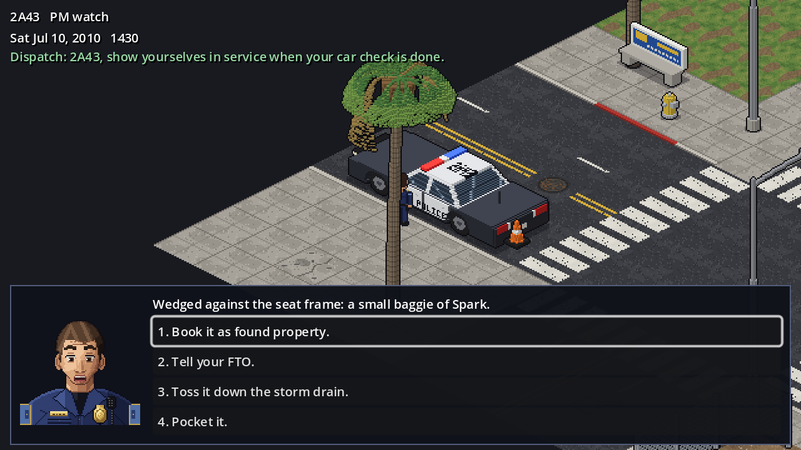

# Rampart

Rampart (working title) is an 18+ pixel-art CRPG in the Baldur's Gate tradition: you play a rookie LAPD officer in 2010, cleaning up after superhumans in the Ledger & Accords world, through an 18-month probation that can end in a career, a scandal, or a funeral.

Built in Godot 4.3 (GDScript, Compatibility renderer).



## Running it

1. Open the folder in Godot 4.3 or later and press Play, or run `godot --path .`
2. Move with WASD, the arrow keys, a stick or a mouse click. Hold Shift to run. Press E to interact and Space to pause.

The current build is the first vertical slice. You start on a Westlake corner at PM watch roll call on Saturday, July 10, 2010. You walk to the Crown Vic and do the first car check (event ST-06, The Back Seat). Whatever you choose is written to the game state as the flags the design calls for.

## Tests

```
godot --headless --path . res://tests/run_tests.tscn
```

These tests cover the check rules and the Composure, stress and Habit rules. They also cover character creation limits, game state, effects, save and load, the event library and scene graphs, the isometric projection, collision on the street map, and a full playthrough of the car check. The runner exits with code 1 on any failure.

To render screenshots of the slice, you need a display or `xvfb-run`:

```
godot --path . -s res://tests/capture_screens.gd -- /path/to/output
```

## Project layout

| Path | What it holds |
|---|---|
| `design/` | The game design document, one file per section |
| `scripts/systems/` | Rules: percentile checks, the officer's attributes, skills and Composure, Habits |
| `scripts/autoload/` | `GameState` (flags, reputation, relationships, clock, save/load) and `EventLibrary` (the 155 scripted events and playable scenes) |
| `scripts/world/` | Isometric projection, the street map builder, the officer on foot |
| `scripts/ui/` | HUD, with tunnel vision at low Composure, and the dialogue box, with portraits and visible odds |
| `scenes/` | `main.tscn`, the vertical slice |
| `data/events/events.json` | All 155 scripted events from section 17 as data, generated from the design document |
| `data/scenes/` | Playable scene graphs, one per built event |
| `data/maps/` | District blocks: tiles, props, vehicles, blockers, spawn |
| `art/` | Generated sprites, portraits, tiles, props and the Crown Vic |
| `tools/` | Procedural art scripts, the event and map builders |
| `tests/` | Headless test runner and screenshot capture |

## Tools

All art is procedural. To rebuild it, you need Python 3 with Pillow, numpy and scipy:

```
tools/build_art.sh          # officer sprite sheet and SpriteFrames, portraits, street tiles and TileSet, props, Crown Vic
python3 tools/build_events.py   # design/17-scripted-events.md -> data/events/events.json
python3 tools/make_map.py       # the Westlake test intersection -> data/maps/westlake_intersection.json
```

The design document is the source of truth for events. Edit `design/17-scripted-events.md`, then rerun `build_events.py`. The builder checks the event counts per category and every cross-reference between events.

### Adding a playable event

Add a JSON file to `data/scenes/` with `event`, `start` and `nodes`. Each node has `text`, an optional `speaker` and `portrait` (a rookie expression), and either `choices`, `next` or `end: true`. A choice can carry `effects`, `requires` conditions, and a `check` (`{"skill": "search", "modifiers": 0}` with `on_success` and `on_failure`). Its odds are shown on the button. The tests validate every scene graph. They also check that a scene sets only the flags its event lists in the design.

## Game Design Document

Oct 11, 2026 · @Claude T

1. [Overview](design/01-overview.md)
2. [Setting: Los Angeles, 2010](design/02-setting-los-angeles-2010.md)
3. [Character creation](design/03-character-creation.md)
4. [Attributes, skills and checks](design/04-attributes-skills-and-checks.md)
5. [Habits, stress and trauma](design/05-habits-stress-and-trauma.md)
6. [Combat](design/06-combat.md)
7. [Combat by background, FTO and partner](design/07-combat-by-background-fto-and-partner.md)
8. [Shifts, calls and playthrough styles](design/08-shifts-calls-and-playthrough-styles.md)
9. [Report writing](design/09-report-writing.md)
10. [Court testimony](design/10-court-testimony.md)
11. [Cast: the department](design/11-cast-the-department.md)
12. [Cast: personal life](design/12-cast-personal-life.md)
13. [Relationships and romance](design/13-relationships-and-romance.md)
14. [World, Rampart, map and movement](design/14-world-rampart-map-and-movement.md)
15. [Main story and casework](design/15-main-story-and-casework.md)
16. [Progression, difficulty, content and presentation](design/16-progression-difficulty-content-and-presentation.md)
17. [Scripted events](design/17-scripted-events.md)
18. [Open questions and sources](design/18-open-questions-and-sources.md)
