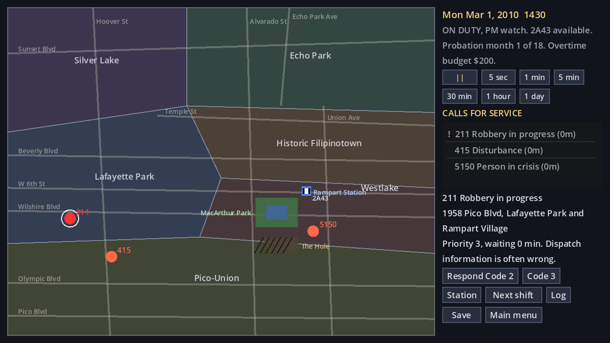
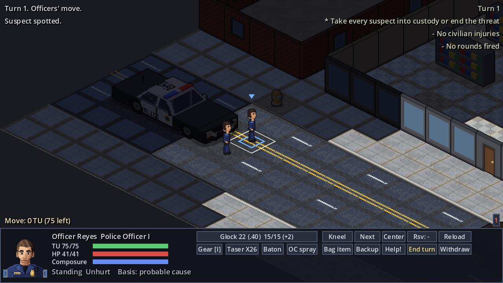
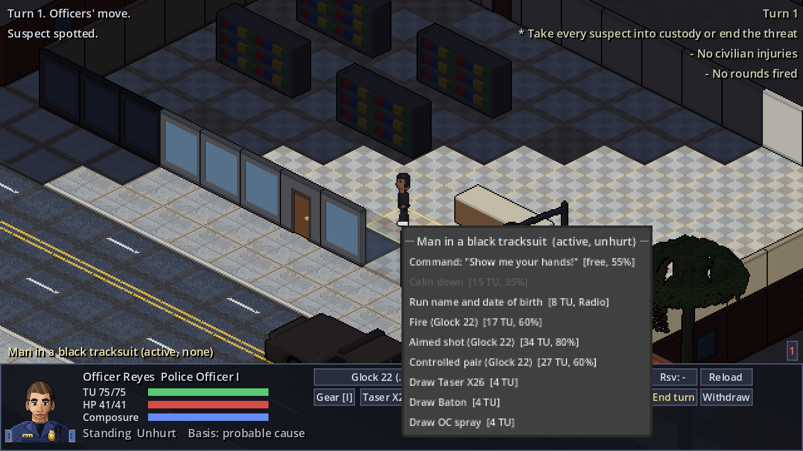
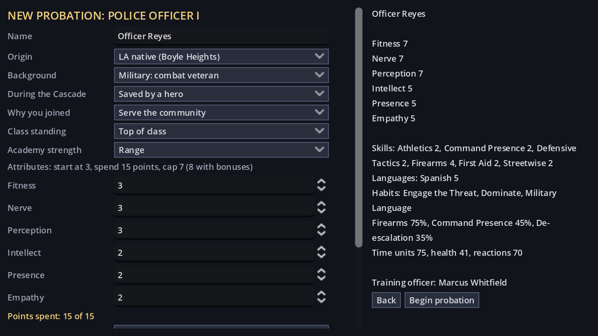

# Rampart

Rampart (working title) is an 18+ pixel-art CRPG in the Baldur's Gate tradition: you play a rookie LAPD officer in 2010, cleaning up after superhumans in the Ledger & Accords world, through an 18-month probation that can end in a career, a scandal, or a funeral.

Built in Godot 4.3 (GDScript, Compatibility renderer).


## What's built

Rampart plays as a port of *UFO: Enemy Unknown* and *Xenonauts*, with all-original code and art (see [design section 19](design/19-xcom-port.md)):

- **Division map (Geoscape):** compressed time. Calls for service appear across six districts, waiting calls escalate or go to other units, and your car responds Code 2 or Code 3. Dated 2010 events show up as news, and a monthly review grades your work and sets the budget.
- **Battlescape:** isometric and turn-based, with time units, kneeling, snap and aimed fire, controlled pairs, reaction fire, fog of war, night and streetlights, walls with doors and windows, and cover that stops rounds or doesn't. Missed rounds travel on through glass and drywall and into bystanders.
- **Police procedure:** commands, de-escalation, records checks, witnesses, pat-downs, cuffs and first aid. Taser, OC spray, beanbag and baton. Legal basis is tracked, and every use of force is reviewed.
- **People:** suspects with dispositions and states who surrender, flee, draw hidden weapons or shoot. Civilians freeze, hide and get hurt. Composure and Habits take over when officers panic.
- **Station:** the roster from section 11, the crew of 2A43, backup units, kit room loadouts, range time and the field manual.
- **Character creation:** origin, background, academy record, attributes, traits, flaw and Ironman. Your record and background assign your training officer.
- **Dispatch and personnel:** structure studied from *This Is the Police 2* (see [design section 20](design/20-dispatch-and-personnel.md)):
  - False alarms and prank flags, and weekday, payday and month call volume.
  - On-scene choice scenes for every call type, where the best officer for the job makes the roll and bad turns go to the battlescape.
  - Officer energy, lateness, hangovers, day-off requests and Code 3 crashes when tired.
  - Story beats from section 17 placed on the calendar.
- **Prologue:** the first car check (event ST-06, The Back Seat).
- **Data:** all 155 scripted events from section 17.

| | |
|---|---|
|  |  |
|  |  |

## Running it

1. Open the folder in Godot 4.3 or later and press Play, or run `godot --path .`
2. Start with **New probation**, or use **Quick battle** to play any call type on its own.

### Controls

| Where | Control |
|---|---|
| Division map | Click a call, then press Respond Code 2 or Code 3. The time buttons run the clock |
| Battlescape: moving | Click an officer to select it, click ground to move (the cost shows at the cursor), right-click to turn |
| Battlescape: people | Left- or right-click a person for the police action menu |
| Battlescape: firing | Choose a mode from the weapon button, then click a target |
| Battlescape: keys | K kneel, N next officer, C center, R reload, P bag evidence, I gear, Enter end turn, WASD or arrows pan, mouse wheel zoom |
| Prologue | WASD or arrows or click to move, E interact, Space pause |

## Tests

```
godot --headless --path . res://tests/run_tests.tscn       # rules, campaign, data; exits 1 on failure
godot --headless --path . -s res://tests/check_scripts.gd  # loads every script and scene
xvfb-run godot --path . -s res://tests/capture_game.gd -- /tmp/shots   # screenshots of every screen
```

The tests cover:
- **Rules:** checks, Composure, Habits and creation rules; tactical movement costs, line of sight, cover and hit chance.
- **Tactical play:** reaction fire, commands and arrests, less-lethal options, bleeding and the use-of-force review. Random play runs across every call type and outcome.
- **Campaign:** call generation, escalation, dispatch, mission results, the monthly review, and saving and loading.
- **Data:** the event library and scene graphs.

## Project layout

| Path | What it holds |
|---|---|
| `design/` | The game design document, one file per section |
| `scripts/systems/` | Percentile checks, the officer's attributes, skills and Composure, Habits |
| `scripts/tactical/` | Battlescape rules (`mission.gd`), map, units, pathfinding, AI, the map generator |
| `scripts/tactical/view/` | Battlescape rendering, the control panel, unit sprites |
| `scripts/strategic/` | Main menu, character creation, division map, station, ending |
| `scripts/autoload/` | `GameState`, `EventLibrary`, `Campaign` (the strategic layer), `Flow` (screens) |
| `scripts/world/`, `scripts/prologue.gd` | The prologue street scene |
| `data/tactical/items.json` | Equipment, fire modes, ranges, loadouts |
| `data/strategic/` | Call types (truths, false alarms, volume), Rampart officers, character creation, day-off reasons, story schedule |
| `data/scenes/calls/` | On-scene choice scenes, one per call type |
| `data/events/events.json` | All 155 scripted events, generated from the design |
| `art/` | Generated sprites, portraits, tiles, walls, props and cars |
| `tools/` | Procedural art scripts and the event, map and tileset builders |
| `tests/` | Test runner, script checker, screenshot capture |

## Tools

All art is procedural. To rebuild it, you need Python 3 with Pillow, numpy and scipy:

```
tools/build_art.sh              # officers, portraits, people, street tiles, walls, interiors, props, cars, tilesets
python3 tools/build_events.py   # design/17-scripted-events.md -> data/events/events.json
python3 tools/make_map.py       # the prologue's Westlake corner -> data/maps/westlake_intersection.json
```

The design document is the source of truth for events. Edit `design/17-scripted-events.md`, then rerun `build_events.py`.

### Adding a playable event

Add a JSON file to `data/scenes/` with `event`, `start` and `nodes`. Each node has `text`, an optional `speaker` and `portrait`, and either `choices`, `next` or `end: true`. A choice can carry `effects`, `requires` conditions, and a `check` (`{"skill": "search", "modifiers": 0}` with `on_success` and `on_failure`). The tests validate every scene graph.

## Game Design Document

Oct 11, 2026 · @Claude T

1. [Overview](design/01-overview.md)
2. [Setting: Los Angeles, 2010](design/02-setting-los-angeles-2010.md)
3. [Character creation](design/03-character-creation.md)
4. [Attributes, skills and checks](design/04-attributes-skills-and-checks.md)
5. [Habits, stress and trauma](design/05-habits-stress-and-trauma.md)
6. [Encounters: interactions and tactical combat](design/06-encounters-interactions-and-tactical-combat.md)
7. [Combat by background, FTO and partner](design/07-combat-by-background-fto-and-partner.md)
8. [Shifts, calls and playthrough styles](design/08-shifts-calls-and-playthrough-styles.md)
9. [Report writing](design/09-report-writing.md)
10. [Court testimony](design/10-court-testimony.md)
11. [Cast: the department](design/11-cast-the-department.md)
12. [Cast: personal life](design/12-cast-personal-life.md)
13. [Relationships and romance](design/13-relationships-and-romance.md)
14. [World, Rampart, map and movement](design/14-world-rampart-map-and-movement.md)
15. [Main story and casework](design/15-main-story-and-casework.md)
16. [Progression, difficulty, content and presentation](design/16-progression-difficulty-content-and-presentation.md)
17. [Scripted events](design/17-scripted-events.md)
18. [Open questions and sources](design/18-open-questions-and-sources.md)
19. [The X-COM port](design/19-xcom-port.md)
20. [Dispatch, on-scene choices and personnel](design/20-dispatch-and-personnel.md)
